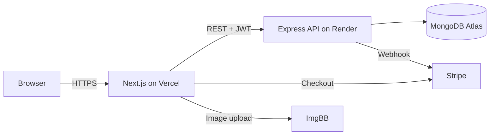

<div align="center">

# FixMate

[](https://fixmate-nu-five.vercel.app)
[](https://github.com/SamaunRezvi/assignment_nine_s)
[](#overview)
[](#key-features)
[](#get-started-locally)

## Broken device? Get it fixed by verified technicians.

FixMate is an on-demand device and home appliance repair service booking platform. Customers send repair requests to verified technicians, track every job through a clear status pipeline, and pay only after the work is completed.

**SMARTPHONES** · **LAPTOPS & PC** · **AC** · **REFRIGERATOR** · **TV** · **WASHING MACHINE** · **ELECTRICAL**

</div>

## Overview [](#overview)

Finding a trustworthy repair technician is hard, and paying before any work is done is risky. FixMate fixes both sides of that problem: every booking has a visible status from request to completion, and payment only happens once the job is marked done.

| | |
|---|---|
| Live site | https://fixmate-nu-five.vercel.app |
| API repository | https://github.com/SamaunRezvi/assignment_nine_s |
| API live URL | https://fixmate-server-qkj7.onrender.com |

## Test Accounts

All seeded accounts use the password `Password123`.

| Role | Email |
|---|---|
| Admin | admin@fixmate.test |
| Technician | rafiq.technician@fixmate.test |
| Technician | nadia.technician@fixmate.test |
| Technician | imran.technician@fixmate.test |
| Customer | tanvir.customer@fixmate.test |
| Customer | sumaiya.customer@fixmate.test |

## How It Works

**01 / FIND A SERVICE**

Browse approved repair services by category, service mode, area or price, with server-side search and sorting.

**02 / SEND A REQUEST**

A customer sends a repair request with their phone, address, preferred date and a description of the problem.

**03 / TRACK THE JOB**

The technician moves the job through requested, accepted, in-progress and completed, with a visual timeline for every stage.

**04 / PAY AFTER COMPLETION**

Once a job is marked completed, the customer pays through Stripe Checkout for the exact amount the technician set.

## Key Features [](#key-features)

- Role-based dashboards for customers, technicians and admins, behind a single collapsible layout
- BetterAuth authentication with email and password, plus Google social sign-in and JWT-protected API routes
- Server-side search, filter (category, service mode, area), sort and pagination on the services listing
- Strict server-enforced job status pipeline (requested, accepted, in-progress, completed, rejected, cancelled) with a visual step tracker per booking
- Stripe Checkout for pay-after-service payments with success and cancel pages
- Rating and review on paid bookings, shown as an average on service cards and details pages
- Derived "verified" badge for technicians with at least one admin-approved service
- Public technician profile pages listing a technician's approved services
- ImgBB image uploads for service listings and profile photos
- Admin tools for user role management, service approval and platform-wide monitoring
- Responsive design across public pages and dashboards, with toasts, empty states and confirmation modals throughout

## Tech Stack

[](https://skillicons.dev)



## Get Started Locally [](#get-started-locally)

```bash
git clone https://github.com/SamaunRezvi/assignment_nine_c.git
cd assignment_nine_c
npm install
cp .env.example .env.local
npm run dev
```

### Environment Variables

| Variable | Description |
|---|---|
| `NEXT_PUBLIC_SERVER_URL` | Base URL of the FixMate API |
| `NEXT_PUBLIC_CLIENT_URL` | This app's own public URL |
| `NEXT_PUBLIC_IMGBB_API_KEY` | ImgBB API key for image uploads |

### Image uploads and verification

Profile photos (all roles), Add Service, and Edit Service use the same image picker.
It previews the selected image and accepts JPG, PNG, WebP, and GIF files up to 10 MB.
Images upload when the form is saved. Editing other fields preserves the existing image.
Set `NEXT_PUBLIC_IMGBB_API_KEY` in the deployment environment before building;
changing it on Vercel requires a new deployment.

- `npm run test:images`: validation and upload response regression tests; no network needed.
- `npm run test:images:host`: uploads a tiny test image using `.env.local` and checks that it loads; requires network access.
- `npm run test:images:browser`: tests the three forms in Chromium with mocked authentication, API persistence, and ImgBB responses. Start the app on port 3019 (`npm run dev -- -p 3019`) and install Playwright separately or set `PLAYWRIGHT_MODULE` to an existing installation. Use `AUDIT_BASE_URL` to test another local port. These tests do not change production users or services.

## Authentication and live notifications

Sign-in and registration load the API profile into the shared auth state before
navigating. Existing sessions visiting Sign In or Sign Up redirect to the correct
role dashboard. Profile loading failures show a retry action.

The bell in the public navigation and dashboard provides live order alerts, an
unread count, notification links, and a saved on/off switch. The authenticated
event stream reconnects automatically. Alerts cover new repair requests, status
changes, cancellations, and payments while the site is open. This is an in-app
notification feature; it does not register browser push notifications.

Deploy the server changes before the client changes. Both use the existing API
URL and JWT configuration; no additional environment variables are needed.

- `npm run test:auth-notifications`: safe redirect and stream parsing tests.
- `npm run test:auth-notifications:browser`: mocked login, registration, delayed
  profile loading, retry, live alerts, saved preferences, and desktop/mobile tests.
  Uses the same local server and Playwright setup as the image browser tests.

## npm Packages Used

next, react, react-dom, tailwindcss, better-auth, date-fns, lucide-react, sonner, and the shadcn/ui component set (radix primitives, class-variance-authority, clsx, tailwind-merge)

<div align="center">

**FIXMATE**

Book the job. Pay after it's done.

[Explore FixMate ↗](https://fixmate-nu-five.vercel.app) · [Back to top ↑](#fixmate)

</div>
